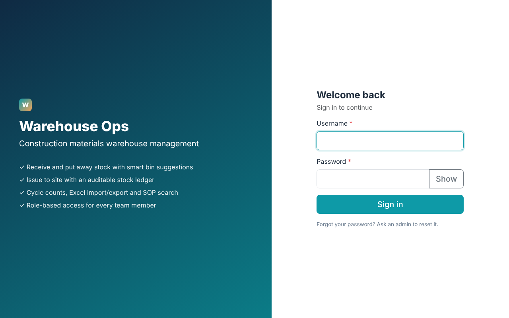
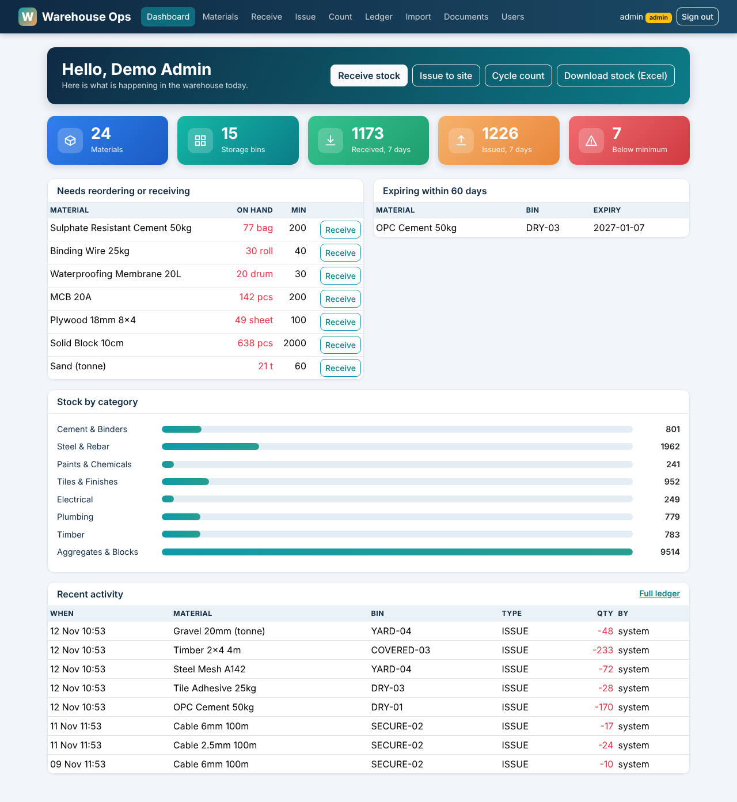
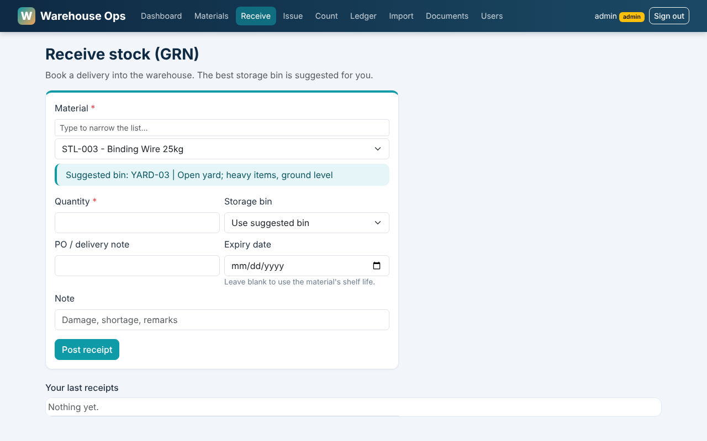
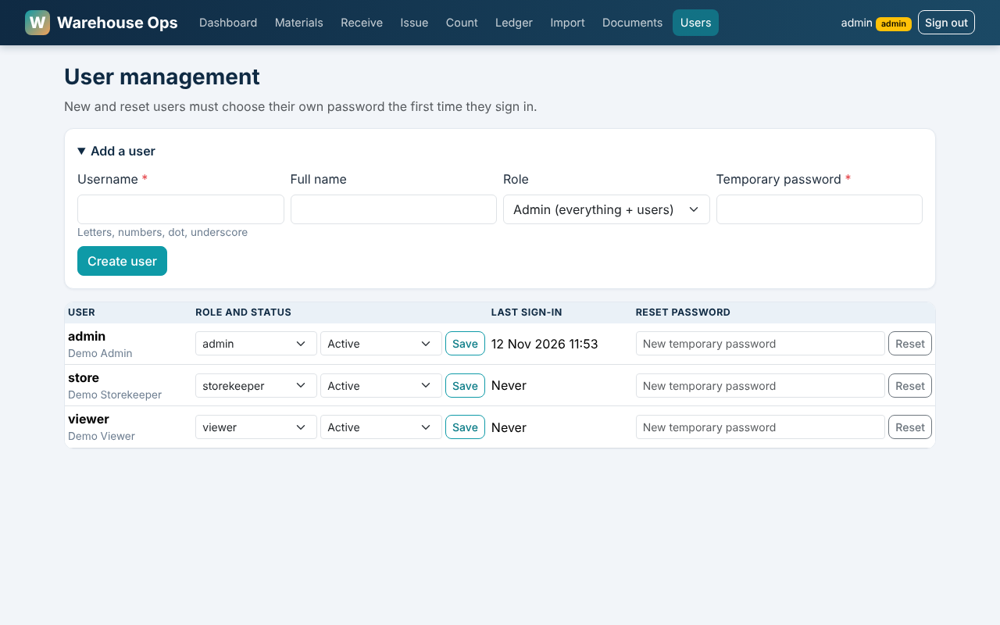

# Warehouse Ops

A warehouse management web app for a **construction materials** business: receive stock with rule-based putaway, issue to site, cycle count, an append-only stock ledger, Excel import/export, document upload with SOP search, and role-based user management.

Product 1 of 3 in a supply-chain portfolio (Warehouse Ops, Inventory Planner, Procurement Hub). Built with Python, Flask, SQLAlchemy, Chroma and Bootstrap.

| Login | Dashboard |
|---|---|
|  |  |
| **Receive stock** | **User management** |
|  |  |

## Features
- **Material master** with categories, units, minimum stock, shelf life and storage rules
- **Receiving (GRN)** with a suggested bin from storage rules (cement to the dry store, paint to the chemical store, rebar to the yard) and automatic expiry from shelf life
- **Issue to site** with stock checks, **cycle counts** that post variances, and an **append-only ledger** (stock on hand = sum of movements)
- **Excel import/export** (materials, opening stock, stock on hand, ledger) and **document upload/download** (PDF, DOCX, TXT, MD, XLSX, CSV)
- **Knowledge search** over uploaded SOPs and data sheets using Chroma (keyword fallback if Chroma is unavailable)
- **Users and roles:** admin, storekeeper, viewer; every ledger row records who posted it

## Quick start
```bash
python -m venv .venv
# Windows PowerShell: .venv\Scripts\Activate.ps1      macOS/Linux: source .venv/bin/activate
pip install -r requirements.txt
python seed.py          # demo data + demo users (skips if data exists; --reset to wipe)
python app.py           # http://localhost:5001
```
Demo logins after seeding: `admin / Admin@1234`, `store / Store@1234`, `viewer / Viewer@1234` (demo only).
Without seeding, the first run creates `admin` and prints a random password in the terminal; you must change it at first sign-in.

Docker: `SECRET_KEY=<random> docker compose up --build`

## Configuration
Set as environment variables (see `.env.example`): `SECRET_KEY`, `ADMIN_PASSWORD`, `DATABASE_URL` (PostgreSQL supported), `IDLE_MINUTES`, `HTTPS`.
If `SECRET_KEY` is not set, a random one is generated at startup (sessions reset on restart).

| Role | Can do |
|---|---|
| admin | Everything, plus user management and deleting documents |
| storekeeper | Receive, issue, cycle count, add materials, Excel import, upload documents |
| viewer | Read-only views and all downloads |

## Security
- Hashed passwords, forced change for new or reset users, common-password check, login lockout, 30-minute idle sign-out
- CSRF tokens on every POST; server-side role checks on every route
- Strict Content-Security-Policy (no inline scripts or styles; Bootstrap is bundled locally), clickjacking and sniffing protection, no caching of authenticated pages
- HttpOnly and SameSite cookies (`HTTPS=1` adds Secure); upload allow-list and size cap; uploads stored under generated names and served as downloads only

## Architecture
```
app.py          Flask routes, models (Material, Bin, Movement, Document, User), auth and role guard
rag.py          Document retrieval behind a small interface (Chroma, keyword fallback)
seed.py         Synthetic construction-materials data and demo users
templates/      Jinja pages        static/   local Bootstrap, app.css, app.js
```
Design notes: stock is never overwritten (every change is a ledger row); numbers come from SQL while documents come from retrieval; the vector store sits behind `rag.py` so pgvector could replace Chroma without touching the app.

## Roadmap
Inventory Planner (forecasting, reorder points, ABC analysis), Procurement Hub (RFQ, PO, three-way match), Claude-generated answers with citations over retrieved documents, automated tests and CI.

## License
MIT, see [LICENSE](LICENSE).
